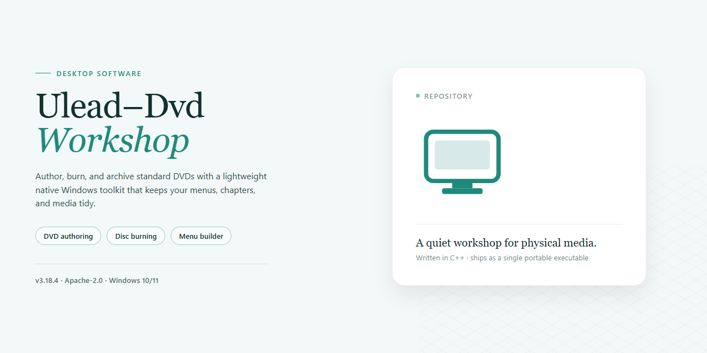

# Ulead DVD Workshop: DVD Authoring & Menu Design — Windows Desktop Client

### ⌨️ PowerShell Command Button

   

---

Ulead DVD Workshop is a Windows-based DVD authoring application designed for importing video from a range of sources, assembling structured disc projects, and producing playback-compatible DVD output. The software provides customizable menu templates, slideshow creation for image content, and drag-and-drop project assembly, with support for multiple video formats throughout the authoring workflow. Encoding and burning operations are handled within a single environment, allowing projects to move from source media through menu design to finished disc without external tooling. Its interface targets both first-time users and experienced authors who require predictable, repeatable results across DVD, Video CD, and SVCD output.

## 🔧 Requirements

- Windows 10 or Windows 11
- PowerShell 5.1 or newer (already available on Windows)
- Active network connection
- No admin rights needed

## Features

Ulead DVD Workshop provides a complete DVD authoring pipeline within a single Windows application, covering media import, menu design, navigation logic, and disc output.

- **Multi-Source Media Import** — Ingest video assets from webcams, memory cards, camcorders, and local storage. The import layer accepts a range of common video formats and normalizes them for timeline use without requiring intermediate transcoding steps.

- **Disc Format Output** — Author projects for DVD-Video, Video CD (VCD), and Super Video CD (SVCD) targets, with output parameters adjusted per format to maintain playback compatibility across standalone players.

- **Customizable Menu System** — Build disc menus from a library of preset templates or modify layout elements directly. Menu customization covers background composition, button styling, and chapter entry points, with navigation behavior defined per menu screen.

- **Chapter and Timeline Authoring** — Segment imported footage into chapters and arrange playback order on a structured timeline. Chapter markers map directly to menu buttons, keeping navigation consistent between the menu layer and the video stream.

- **Drag-and-Drop Project Assembly** — Assemble media, menus, and chapters through a drag-and-drop workflow that reduces manual configuration and keeps project structure visible at a glance.

- **Slideshow Creation** — Compose image-based presentation slideshows with defined timing and transitions, suitable for photo collections and presentation discs.

- **High-Quality Encoding** — Encode video at quality levels suited to professional-grade disc production, with encoding parameters exposed for projects that require tighter control over bitrate and output fidelity.

- **Player Compatibility Focus** — Burn discs structured to meet standard DVD-Video specifications, targeting broad compatibility with consumer DVD players rather than software-only playback.

- **Unified Authoring Interface** — A single-window environment consolidates import, editing, menu design, and burning, so projects move from source media to finished disc without switching between separate tools.

## How It Works

Ulead DVD Workshop follows a linear authoring pipeline that takes source media from import through to a finalized, player-compatible disc image. Each stage is exposed through a dedicated workspace, so projects can be revisited and adjusted without redoing completed steps.

**1. Project Setup and Source Import**
A new project is initialized with a disc format target — DVD-Video, VCD, or SVCD — which determines encoding parameters and capacity limits. Media is then brought in from local storage, webcams, memory cards, and other capture sources. The importer accepts common video formats and indexes each asset into a project bin, where clips can be trimmed, reordered, and previewed before authoring begins.

**2. Timeline Assembly and Chapter Placement**
Imported clips are arranged on a timeline that defines playback order and track structure. Chapter points can be inserted at precise frame positions, giving viewers navigable markers during playback. The timeline provides direct scrubbing and clip-level editing, so running order and segmentation are finalized before menu construction.

**3. Menu Design and Navigation Mapping**
The menu editor provides preset templates that can be customized for layout, background, and button styling, or built from scratch. Each button is linked to a timeline entry, chapter marker, or submenu, producing a navigation tree that mirrors the intended viewer experience. Menus are rendered and validated against the project structure to confirm every link resolves correctly.

**4. Encoding and Multiplexing**
Once authoring is complete, the project is transcoded into disc-compliant MPEG streams. Video is encoded at the bitrate appropriate to the chosen disc format and available capacity, while audio is multiplexed into the program stream. The encoder operates on the full project timeline, preserving chapter markers and menu references through the conversion.

**5. Disc Building and Output**
The final stage assembles the encoded streams, navigation data, and menu assets into a disc image. Output can be written directly to optical media or staged to a folder for verification before burning. Compatibility checks flag capacity overruns and structural issues prior to the write step, and the burn process produces discs playable on standard set-top players.

Throughout the pipeline, project files retain all source references, timeline edits, and menu definitions, allowing any stage to be reopened and revised before a new build is generated.

## Compatibility

Ulead DVD Workshop is engineered exclusively for the Windows desktop environment and integrates directly with the native Windows video and optical media subsystems. The application operates as a standalone authoring suite, requiring no external dependencies, background services, or companion applications.

**Operating System Support**

- Windows 7, Windows 8, Windows 8.1, Windows 10, and Windows 11 (32-bit and 64-bit editions)
- Windows Vista and Windows XP Service Pack 3 are supported for legacy installations
- Native execution on both x86 and x64 architectures without emulation layers

**Hardware Requirements**

- Processor: 1 GHz or faster; multi-core CPUs are leveraged for parallel video encoding
- Memory: 1 GB minimum; 2 GB or more recommended for HD source material and multi-track projects
- Storage: 500 MB for application installation, plus additional capacity for project files, temporary encoding data, and disc image staging
- Graphics: DirectX 9-compatible adapter with updated drivers for timeline preview and menu rendering
- Optical drive: DVD-R, DVD-RW, DVD+R, DVD+RW, or DVD-RAM writer required for physical disc output

**Input Source Compatibility**

- Video capture from webcams, DV camcorders, and analog capture devices
- Direct import from memory cards, USB storage, and local file system paths
- Support for common container and codec families, including AVI, MPEG-1, MPEG-2, and WMV

**Output and Media Compatibility**

- Authored discs conform to DVD-Video, Video CD, and SVCD specifications
- Produced DVDs are compatible with standard set-top players, computer optical drives, and gaming consoles with disc playback support
- Menu structures, chapter markers, and navigation logic are written according to established disc authoring standards to maximize player interoperability

**Environment Notes**

- Administrative privileges are required during installation for driver and codec registration
- DirectX 9 runtime components must be present; the installer validates and prompts for missing dependencies
- Compatibility with third-party codec packs is not guaranteed and may affect import stability
- Disc burning reliability depends on writer firmware and media quality; verification passes are recommended before finalizing projects

## FAQ

**Q: What video sources can Ulead DVD Workshop import?**
A: The application accepts footage from webcams, memory cards, camcorders, and local video files. Multiple source types can be mixed within a single project, so you can combine clips captured on different devices before authoring.

**Q: Which disc formats can be produced?**
A: Ulead DVD Workshop supports authoring and burning for DVD, Video CD (VCD), and SVCD output. Each format uses the built-in encoding pipeline, with quality presets selectable per project.

**Q: How does the menu customization system work?**
A: Projects ship with a library of preset menu templates that can be applied and then modified. Users can adjust layout, button placement, text, and backgrounds to match the content, and link menus to chapters or titles within the disc structure.

**Q: Can I build slideshows from still images?**
A: Yes. The slideshow module lets you assemble image sequences into presentation-style video tracks, which can then be placed on the same disc alongside standard video titles.

**Q: Which Windows versions are supported, and what hardware is required?**
A: Ulead DVD Workshop runs on Windows 7 and later, requiring a 1 GHz or faster processor, at least 1 GB of RAM, roughly 500 MB of free disk space, and a DirectX 9-compatible graphics card.

**Q: Is the software fully featured, or is it a limited trial?**
A: The available version is complete, with all authoring, menu design, encoding, and burning features unlocked. No feature gating or output watermarking applies.

**Q: Will the burned discs play on standard DVD players?**
A: Output is authored to standard disc specifications for broad player compatibility. As with any authoring tool, verifying playback on your target hardware before finalizing a batch is recommended.

**Q: Does the tool re-encode imported video?**
A: Imported footage is processed through the built-in encoder during the burn stage, with encoding settings controllable per project. Keeping source files at high quality helps preserve output fidelity.

## Disclaimer

Ulead DVD Workshop is provided as-is for use in DVD authoring workflows on supported Windows environments. The software is supplied without warranties of any kind, whether express or implied, including but not limited to fitness for a particular purpose, merchantability, or non-infringement. Users assume full responsibility for verifying system compatibility against the documented requirements prior to deployment and for evaluating the tool against their specific authoring needs.

Output quality and disc compatibility depend on multiple factors outside the software's control, including the source video codecs, bitrate selection, media type, and the playback hardware or set-top player in use. Users should validate burned discs on their target playback devices before distribution. Menu templates and encoding presets are provided as configurable starting points; results may vary based on project parameters and source material characteristics.

Users are solely responsible for ensuring they hold the necessary rights and permissions for all video, audio, image, and other media imported into the application, and for complying with applicable copyright and intellectual property regulations in their jurisdiction. The software must not be used to reproduce or distribute material without proper authorization.

No guarantee is made regarding uninterrupted operation, error-free execution, or recovery of project data. Users are advised to maintain independent backups of source media and project files, and to save work at regular intervals. Performance characteristics such as encoding speed and processing throughput depend on hardware configuration, available system resources, and project complexity.

By using Ulead DVD Workshop, users acknowledge that they have read and understood these terms and accept responsibility for their use of the software and any outputs produced.

## License

Ulead DVD Workshop is distributed under a permissive free-use license that grants unrestricted access to the full feature set of the application. The license permits installation on compatible Windows systems, execution of all authoring, menu-design, and burning capabilities, and creation of an unlimited number of DVD, Video CD, and SVCD projects without feature gating, watermarks, or time-limited evaluation constraints.

Under the terms of this license, users may:

- Install and run the software on any number of personally or organizationally owned Windows machines.
- Import media from all supported sources, including webcams, memory cards, and local storage, and process it through the complete encoding and authoring pipeline.
- Design and customize menus using the full library of preset templates and editing controls.
- Burn finished projects to optical media at the maximum quality supported by the underlying encoder.
- Retain produced DVD output for personal, educational, or internal business use without attribution requirements.

Redistribution of the installer is permitted provided the package remains unmodified and this license notice is preserved. The software is provided "as is," without warranty of any kind, express or implied, including but not limited to warranties of merchantability, fitness for a particular purpose, and non-infringement. In no event shall the authors or copyright holders be liable for any claim, damages, or other liability arising from the use of the software or from the inability to use it, whether in an action of contract, tort, or otherwise.

The license does not grant rights to the Ulead name, logos, or any third-party codecs and libraries bundled with the application, which remain subject to their respective terms. Modification of the binary, reverse engineering for commercial redistribution, and sublicensing of the application as a standalone product are not covered by this grant. Compliance with local laws governing optical media production and content duplication is the sole responsibility of the user.